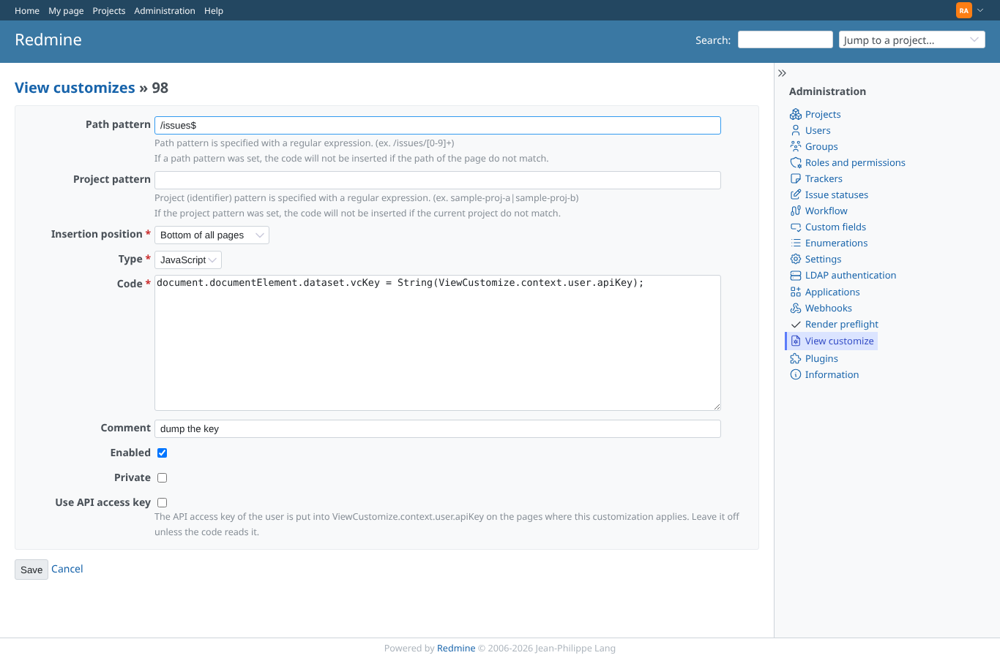
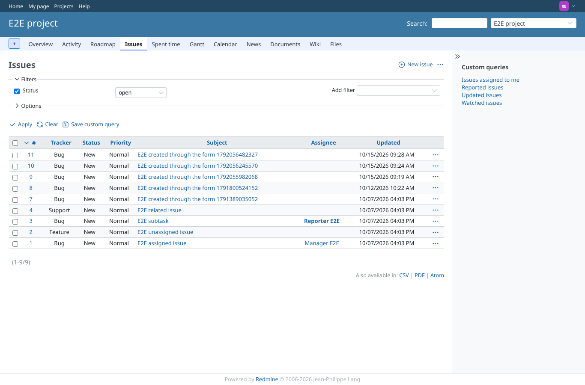
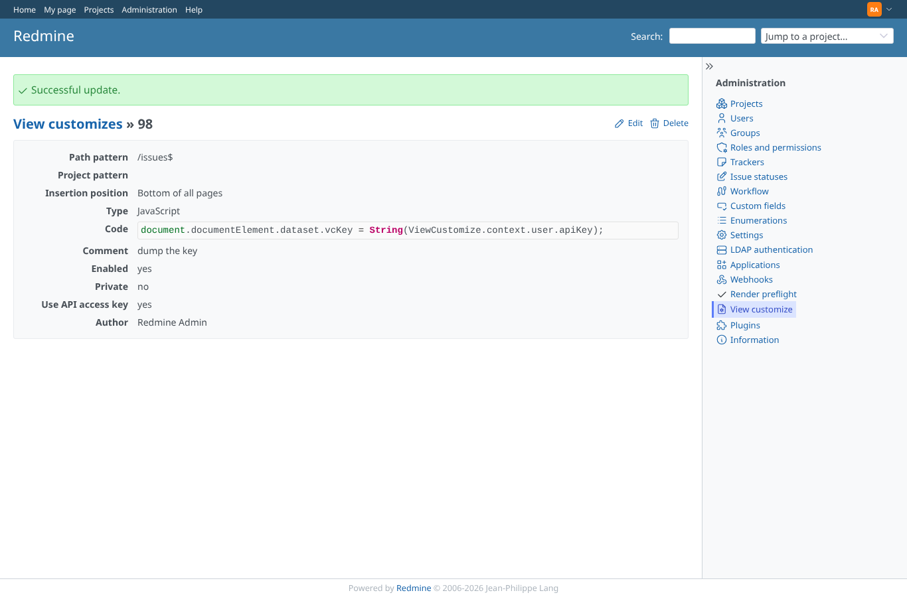
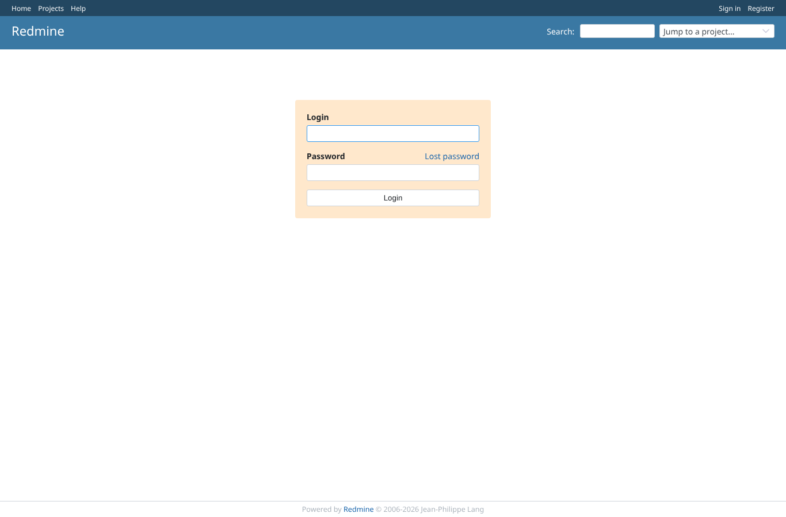

# apikey

Run 2026-10-15T09:31:57.637Z against http://127.0.0.1:3000.

| screenshot | user | URL | shows |
|---|---|---|---|
|  | admin | `/view_customizes/98/edit` | The customization form: "Use API access key" is off by default, with its explanation |
|  | reporter | `/projects/e2e-project/issues` | reporter: setting ON but nothing asks for the key, the page gets apiKey = null |
|  | admin | `/view_customizes/98` | Show page after opting in |
|  | reporter | `/projects/e2e-project/issues` | reporter: the opted-in customization applies here, the key is in the context (value on the page via the dump) |
|  | anonymous | `/login` | anonymous on the login page: apiKey = null although an opted-in customization applies |
